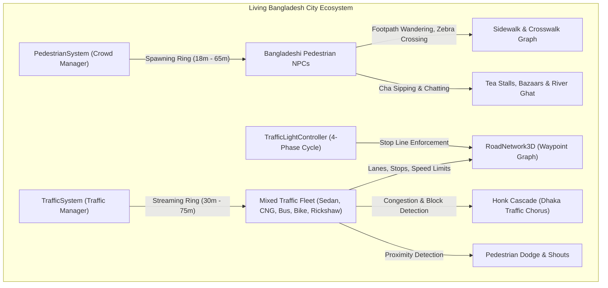
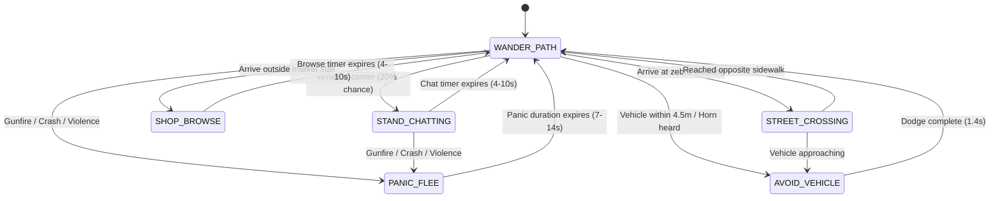

# LIVING BANGLADESH CITY SIMULATION ARCHITECTURE
## Pedestrian Crowds, Mixed Multi-Modal Traffic, Road Networks & Traffic Signals

**Project**: *DTA: Dhaka Theft Auto* (Project Sonar Bangla)  
**Engine & Pipeline**: Godot 4.7 Forward+ / Jolt Physics / GDScript  
**Pedestrian System**: [pedestrian_system.gd](file:///c:/Users/Tonmoy/Documents/DTA%200/scripts/pedestrians/pedestrian_system.gd)  
**Pedestrian Agent**: [bangladeshi_pedestrian.gd](file:///c:/Users/Tonmoy/Documents/DTA%200/characters/pedestrians/bangladeshi_pedestrian.gd)  
**Road Network Graph**: [road_network_3d.gd](file:///c:/Users/Tonmoy/Documents/DTA%200/world/traffic/road_network_3d.gd)  
**Traffic Controller**: [traffic_system.gd](file:///c:/Users/Tonmoy/Documents/DTA%200/world/traffic/traffic_system.gd)  
**Autonomous AI Driver**: [traffic_vehicle_agent.gd](file:///c:/Users/Tonmoy/Documents/DTA%200/world/traffic/traffic_vehicle_agent.gd)  
**Traffic Light System**: [traffic_light.gd](file:///c:/Users/Tonmoy/Documents/DTA%200/world/traffic/traffic_light.gd)  
**Diagnostic Test Harness**: [test_city_simulation.tscn](file:///c:/Users/Tonmoy/Documents/DTA%200/tests/test_city_simulation.tscn)  

---

## 1. LIVING CITY OVERVIEW

Urban Bangladesh is defined by intense social density, vibrant street-level human interaction, and a unique multi-modal traffic ecosystem where high-tech modern sedans share asphalt with pedal rickshaws, buzzing 2-stroke CNGs, and multi-ton municipal buses.

---

## 2. PEDESTRIAN CROWD SYSTEM & DEMOGRAPHICS

### 2.1 Authentic Demographic Archetypes
Pedestrian NPCs are categorized into 5 culturally distinct archetypes with randomized attire, accessories, and walking cadences:

| Archetype | Cultural Description & Attire | Speed | Typical Hotspots |
|---|---|---|---|
| **Chacha Panjabi** | Elderly citizen wearing white/cream Panjabi, checked Lungi, Islamic prayer cap (*Tupi*), gray beard. | $1.8\,\text{m/s}$ | Roadside tea stalls, river ghat, mosque perimeter. |
| **Student Youth** | Young modern citizen wearing graphic t-shirt, dark denim jeans, sneakers, carrying backpack. | $2.4\,\text{m/s}$ | Commercial bazaar, sidewalks, bus terminal. |
| **Hawker / Laborer** | Street vendor / worker wearing sleeveless cotton vest (*Ganji*), folded Lungi to knees, neck towel (*Gamcha*). | $2.6\,\text{m/s}$ | Market alleys, curbside fruit stalls, workshop lane. |
| **Office Babu** | Corporate / government executive in formal light blue collared shirt, dark charcoal slacks, dress shoes. | $2.2\,\text{m/s}$ | Main road footpaths, police station access road. |
| **Female Citizen (Apu)** | Traditional colorful Salwar Kameez with matching draped Dupatta (*Orna*) in magenta or emerald green. | $2.1\,\text{m/s}$ | Commercial bazaar shops, residential footpaths. |

### 2.2 Pedestrian Behavior State Machine

- **Vehicle Avoidance Reaction**: Front-facing `RayCast3D` detects approaching vehicles. If a car gets within 4.5m or honks nearby, the pedestrian sidesteps onto the curb and plays a vocal shout (`pedestrian_shout_1.wav` or `pedestrian_shout_2.wav`).
- **Day/Night Routine Schedules**:
  - *Daytime (07:00 - 18:00)*: Pedestrian density 85% — heavy flow around commercial markets and transit terminals.
  - *Evening (18:00 - 23:00)*: Pedestrian density 100% — intense crowds congregating around Bismillah Tea Stall and street food vendors.
  - *Late Night (23:00 - 06:00)*: Pedestrian density drops to 25% — quiet alleys, lone commuters.

---

## 3. MIXED BANGLADESH TRAFFIC ECOSYSTEM

### 3.1 Traffic Modal Split
Traffic spawning accurately reproduces the vehicular distribution of Dhaka streets:
- **35% CNG Auto-Rickshaws** (Agile, fast, noisy 2-stroke buzz, lane weaving)
- **25% Private Sedans** (Toyota Allion/Premio style commuter traffic)
- **15% Motorcycles** (Commuter 150cc bikes, fast acceleration, lane-splitting)
- **10% Local City Buses** (*Murir Tin*, massive multi-ton momentum, loud pneumatic air horns)
- **10% Cycle Rickshaws** (Slow pedal transport, keeping near curbs)
- **5% Utility Vehicles** (Commercial delivery vans, pickups, and SUVs)

### 3.2 Waypoint Road Network Graph (`RoadNetwork3D`)
A directed cyclic graph defining lanes, direction vectors, speed limits, and stop lines:
- **Lane 1 (Southbound Main Road)**: $X = -2.2\text{m}$, speed limit $55\,\text{km/h}$, stop-line at $Z = -45\text{m}$.
- **Lane 2 (Northbound Main Road)**: $X = +2.2\text{m}$, speed limit $55\,\text{km/h}$, stop-line at $Z = -30\text{m}$.
- **Lane 3 (Eastbound Bazaar Ave)**: $Z = -39.5\text{m}$, speed limit $40\,\text{km/h}$, stop-line at $X = -8\text{m}$.
- **Lane 4 (Westbound Bazaar Ave)**: $Z = -36.5\text{m}$, speed limit $40\,\text{km/h}$, stop-line at $X = +8\text{m}$.

### 3.3 Autonomous AI Driving Behaviors (`TrafficVehicleAgent`)
1. **Lane Following**: Uses PID-controlled steering to track waypoints with lookahead curvature smoothing.
2. **Obstacle Avoidance & Braking**: Dynamic raycasting calculates stopping distance based on current speed ($d_{\text{safe}} = 4.0\text{m} + 0.25 \times v_{\text{km/h}}$), smoothly applying brakes behind lead vehicles or stopped pedestrians.
3. **Traffic Jam Honk Cascade**: If a vehicle remains stationary behind an obstacle for $> 2.8\,\text{s}$, it sounds its horn. Surrounding vehicles in congestion hear the honk and emit staggered reply honks ($0.3\text{s} - 0.8\text{s}$ jitter), recreating authentic Dhaka traffic congestion audio.
4. **Overtaking Behavior**: When trapped behind a slow-moving vehicle (e.g. pedal rickshaw traveling at $15\,\text{km/h}$), the AI checks adjacent lane raycasts. If clear over an 18m window, it offsets its path, accelerates, and merges safely ahead.

---

## 4. 4-PHASE TRAFFIC LIGHT INTERSECTION

Positioned at the central crossroads of the Main Road and Bazaar Avenue $(X = 0, Z = -38)$:
- **Phase 1: North-South GREEN ($12.0\,\text{s}$)**: Main Road traffic flows across the bridge; East-West Bazaar traffic halts at the stop line.
- **Phase 2: North-South YELLOW ($3.0\,\text{s}$)**: Caution phase; approaching vehicles brake.
- **Phase 3: East-West GREEN ($10.0\,\text{s}$)**: Bazaar Avenue commercial traffic flows across the intersection.
- **Phase 4: East-West YELLOW ($3.0\,\text{s}$)**: Caution transition back to North-South.
- **Visual Gantry**: Overhead steel truss with active directional `SpotLight3D` units and high-emission colored lenses.

---

## 5. PERFORMANCE OPTIMIZATION & DISTANCE-BASED LOD

1. **Streaming Rings**:
   - Spawning occurs exclusively in a doughnut ring around the player ($18\text{m} - 65\text{m}$ for pedestrians, $30\text{m} - 75\text{m}$ for vehicles).
   - Entities outside $75\text{m} - 95\text{m}$ are cleanly recycled/despawned.
2. **Configurable Densities**:
   - `PedestrianSystem.pedestrian_density`: $0.0$ to $1.0$ (up to 35 active humanoids).
   - `TrafficSystem.traffic_density`: $0.0$ to $1.0$ (up to 14 active autonomous vehicles).
3. **Physics Tick Decoupling**:
   - Distant NPCs ($> 30\text{m}$) utilize low-frequency tick scheduling, preserving 60 FPS Forward+ performance.

---

## 6. DIAGNOSTIC TEST HARNESS

The interactive test scene [test_city_simulation.tscn](file:///c:/Users/Tonmoy/Documents/DTA%200/tests/test_city_simulation.tscn) provides live diagnostic controls:
- `[1] / [2]`: Increase / Decrease Pedestrian Crowd Density ($10\% - 100\%$).
- `[3] / [4]`: Increase / Decrease Mixed Traffic Density ($10\% - 100\%$).
- `[T]`: Force cycle traffic light phase.
- `[P]`: Trigger panic signal (tests crowd scatter and screaming reactions).
- Real-time telemetry HUD displaying active pedestrian count, vehicle fleet, current traffic light phase, and live honk event logs.
