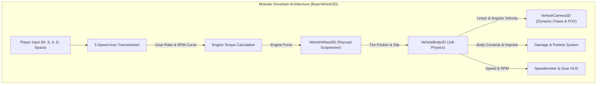
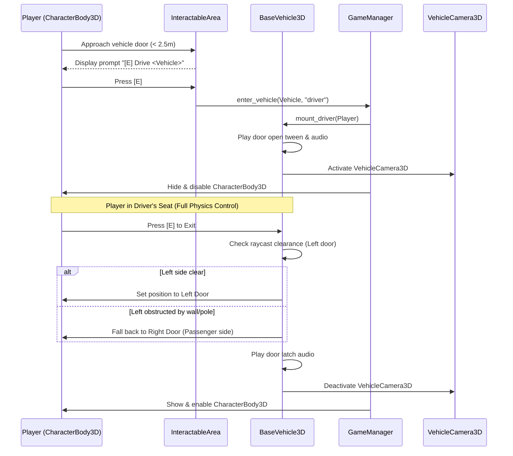

# BANGLADESH VEHICLE SYSTEM ARCHITECTURE
## Modular Open-World Physics, Drivetrain Simulation & Vehicle Roster

**Project**: *DTA: Dhaka Theft Auto* (Project Sonar Bangla)  
**Engine & Physics**: Godot 4.7 Forward+ / Jolt Physics Engine / GDScript  
**Base Architecture**: `VehicleBody3D` + `VehicleWheel3D` (Raycast Suspension)  
**Base Class**: [base_vehicle_3d.gd](file:///c:/Users/Tonmoy/Documents/DTA%200/vehicles/base_vehicle_3d.gd)  
**Camera Controller**: [vehicle_camera_3d.gd](file:///c:/Users/Tonmoy/Documents/DTA%200/vehicles/vehicle_camera_3d.gd)  
**Diagnostic Test Track**: [test_vehicle_physics.tscn](file:///c:/Users/Tonmoy/Documents/DTA%200/tests/test_vehicle_physics.tscn)  

---

## 1. ARCHITECTURAL OVERVIEW & PHYSICS PRINCIPLES

Rather than faking vehicular movement through simplified kinematic CharacterBody translation, the *DTA* vehicle system implements genuine Newtonian rigid body mechanics powered by Godot 4's Jolt Physics engine:

### Core Physics Pillars
1. **Raycast Suspension**: Each `VehicleWheel3D` casts a physics ray downward from the chassis mounting point. It calculates spring displacement, spring force ($F = -k \cdot x$), compression damping, and relaxation damping on every physics tick.
2. **Speed-Sensitive Steering**: At low velocity ($< 25\,\text{km/h}$), the steering angle expands to $34^\circ - 42^\circ$ for tight urban U-turns and alley maneuvering. At high velocity ($> 100\,\text{km/h}$), steering dynamically contracts to $11^\circ - 14^\circ$, preventing violent oversteer spinouts.
3. **Weight Transfer Dynamics**: Under heavy throttle, the vehicle pitches backward (rear suspension squats); under heavy braking, load transfers forward (front suspension dives), creating convincing body roll.

---

## 2. DRIVETRAIN & TRANSMISSION SIMULATION

### 2.1 Multi-Gear Automatic Transmission
Vehicles utilize a 5-speed simulated transmission with authentic gear ratios:

$$\text{Engine Force Output} = \text{Max Engine Force} \times \text{Throttle} \times \frac{|\text{Gear Ratio}|}{2.0}$$

| Gear | Ratio | Speed Operating Range | RPM Behavior |
|---|---|---|---|
| **Reverse (R)** | -3.2 | $0 - 32\,\text{km/h}$ | Activated by holding Brake (S) at full stop ($< 1.5\,\text{km/h}$). |
| **Neutral (N)** | 0.0 | $0\,\text{km/h}$ | Free-wheeling rolling friction. |
| **1st Gear** | 3.6 | $0 - 38\,\text{km/h}$ | High wheel torque for launching and slope climbing. |
| **2nd Gear** | 2.2 | $30 - 68\,\text{km/h}$ | Urban cruising and sharp turn acceleration. |
| **3rd Gear** | 1.5 | $60 - 98\,\text{km/h}$ | Overtaking gear on main avenues. |
| **4th Gear** | 1.0 | $90 - 132\,\text{km/h}$ | Direct drive highway cruising. |
| **5th Gear** | 0.8 | $120 - 175+\,\text{km/h}$ | Overdrive top speed. |

### 2.2 Real-Time Engine RPM Curve & Audio Modulator
- **Idle RPM**: $850\,\text{RPM}$
- **Redline Upshift Threshold**: $5800\,\text{RPM}$ (triggers $0.18\,\text{s}$ clutch disengage shift delay)
- **Downshift Threshold**: $2400\,\text{RPM}$
- **Audio Pitch Modulation**:
  $$\text{Pitch Scale} = 0.75 + \left(\frac{\text{Current RPM}}{\text{Max RPM}}\right) \times 1.35$$

---

## 3. COMPLETE ROSTER: 8 BANGLADESH-INSPIRED VEHICLES

| # | Vehicle Name | Inspiration / Class | Mass | Max Speed | Drive Type | Key Behavioral & Cultural Characteristics |
|---|---|---|---|---|---|---|
| **1** | **Shonar Toron Sedan** | Toyota Allion / Premio / Corolla | $1350\,\text{kg}$ | $165\,\text{km/h}$ | RWD | Dhaka's quintessential family car. Balanced handling, low center of gravity, operable hinged driver door, 4 alloy wheels, dual SpotLight3D headlights. |
| **2** | **Meghna Explorer 4x4** | Toyota Prado / Mitsubishi Pajero | $2150\,\text{kg}$ | $175\,\text{km/h}$ | 4WD | Luxury corporate & diplomatic SUV. Heavy mass, 4-wheel drive traction, high ground clearance ($0.52\text{m}$), rear spare tire, deep V6 rumble. |
| **3** | **Bikrom 150R Motorcycle** | Bajaj Pulsar / Yamaha FZS | $160\,\text{kg}$ | $138\,\text{km/h}$ | 2-Wheel RWD | Agile Dhaka commuter bike. Dynamic procedural lean physics ($\pm 24^\circ$ into turns), instant throttle snap, lane-splitting profile. |
| **4** | **Dhaka Green Auto** | Bajaj 4-Stroke Green CNG Auto-Rickshaw | $450\,\text{kg}$ | $75\,\text{km/h}$ | 3-Wheel RWD | Iconic 3-wheeler (*Baby Taxi*). Green metal cage, high center of mass ($+0.12\text{m}$), high roll influence ($0.35$) creating authentic rollover risk on high-speed turns, buzzy 2-stroke audio. |
| **5** | **Lalbagh Cycle Rickshaw** | Authentic Puran Dhaka Cycle Rickshaw | $85\,\text{kg}$ | $24\,\text{km/h}$ | Human-powered | Traditional 3-wheeler with hand-painted tin art, hood canopy, pedaling inertia, and brass bell sound (`tring-tring`). |
| **6** | **Dhaka City Bus** | Municipal Bus / *Murir Tin* | $7800\,\text{kg}$ | $95\,\text{km/h}$ | Heavy RWD | Multi-ton battering ram. High momentum, pneumatic air brakes, loud air horn (`horn_bus_air.wav`), colorful weathered red/green livery. |
| **7** | **Padma Utility Pickup** | Toyota Hilux / DMP Police Patrol | $1850\,\text{kg}$ | $160\,\text{km/h}$ | RWD | Rugged workhorse pickup. Open rear cargo bed, high ground clearance, heavy-duty suspension for uneven roads and bumps. |
| **8** | **Chander Gari Delivery Van** | Toyota HiAce / Covered Courier Microbus | $1950\,\text{kg}$ | $145\,\text{km/h}$ | RWD | Commercial transport van with large enclosed cargo hold, commercial delivery livery, and mid-range pulling power. |

---

## 4. DYNAMIC VEHICLE CAMERA CONTROLLER (`VehicleCamera3D`)

The dedicated vehicle camera is decoupled from the vehicle body to eliminate high-frequency physics jitter:
- **Mode 1: Chase Far** ($d = 6.2\,\text{m}, h = 2.2\,\text{m}, \text{FOV} = 74^\circ$): Standard open-world follow view.
- **Mode 2: Chase Close** ($d = 4.6\,\text{m}, h = 1.7\,\text{m}, \text{FOV} = 75^\circ$): Tight alley navigation.
- **Mode 3: Hood / Bumper** ($d = 0.2\,\text{m}, h = 1.35\,\text{m}, \text{FOV} = 85^\circ$): High-speed cockpit perspective.
- **Instant Look-Behind Mirror**: Holding `[B]` or reversing flips the camera $180^\circ$ smoothly.
- **Speed FOV Warp**: Dynamically stretches FOV by up to $+12^\circ$ at top speeds.
- **Sphere Collision Avoidance**: Employs an internal `SpringArm3D` with a $0.2\text{m}$ radius sphere to prevent wall clipping.

---

## 5. PLAYER INTERACTION & SAFE EXIT MECHANICS

---

## 6. DIAGNOSTIC VEHICLE TEST TRACK

The dedicated test track scene [test_vehicle_physics.tscn](file:///c:/Users/Tonmoy/Documents/DTA%200/tests/test_vehicle_physics.tscn) verifies:
1. **200m Drag Strip**: Acceleration benchmarking and top speed verification.
2. **Speed Breakers (*Goti Rodhok*)**: 3 graduated road bumps ($0.1\text{m}, 0.18\text{m}, 0.25\text{m}$) testing suspension rebound, damping, and bottom-out limits.
3. **Slopes & Incline Ramps**: $15^\circ$ (slight climb), $30^\circ$ (steep ramp), and $45^\circ$ (extreme barrier) assessing torque and tire friction slip.
4. **Impact Barrier**: Heavy concrete wall testing physics contact reporting, metal crunch audio, and damage particle states.
5. **Real-Time Telemetry HUD**: Live dashboard displaying Vehicle State, Speed, RPM, Gear, Steering Angle, Health, and per-wheel contact/skid telemetry.
